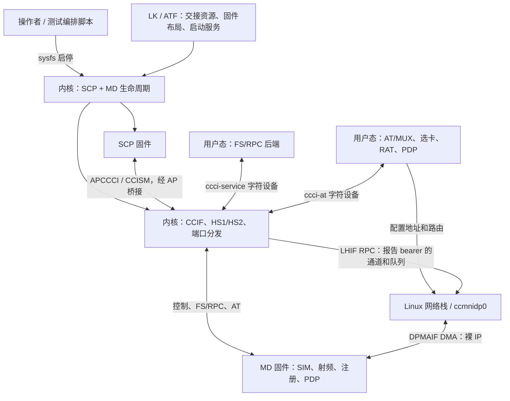

<!-- SPDX-License-Identifier: GPL-2.0-only -->
# op6893 / MT6893 主线基带控制结构

本文以 `001c85f6e` 的源码、工作树候选改动及同板实测为基线。当前接通的是一套显式启动的
板级实验栈：内核持有硬件和协议生命周期，用户态分别提供启动所需的 FS/RPC
应答与联网策略，厂商 MD 固件运行自己的无线协议栈。图中的 AP 指运行主线
Linux 的应用处理器，MD 指基带，SCP 是独立协处理器。

## 内核：硬件所有权、传输和分流

实现集中在 `drivers/misc/mediatek/ccci/`。当前实测使用显式启用相应
配置和板级节点的 op6893 镜像；驱动注册、供电完成或字符设备出现，
都不能单独算作基带就绪。旧实验文档中的“尚无启动 caller”等结论
描述各自当时的节点，当前运行路径见下表。

| 组件 | 主要文件 | 职责 |
| --- | --- | --- |
| MD 平台和启动 | `ccci-md-platform.c`、`ccci-md-power.c`、`ccci-md-boot.c` | 接管 LK 初始状态，管理 MD1 电源域、PMIC 四路电压、CCIF 时钟、prepare/release/off/rearm。释放 MD CPU 走同板 ATF 调用。 |
| LK 交接与共享内存 | `ccci-lk*.c`、`ccci-smem*.c`、`ccci-nvram-cache.c` | 校验并使用 LK 给出的布局，管理 runtime、CCISM、调试区和基带可见的 NVRAM cache；首启与重启使用不同的清理规则。这个 cache 是共享内存，和用户态 NVRAM 文件副本、UFS `cache` 分区各自独立。 |
| SCP 与 CCISM | `ccci-scp-*.c`、`ccci-ccism-*.c` | 管理 26 MHz 资源、复位、TCM/DRAM 恢复、mailbox/IRQ、READY 与 AP awake。向 MD 会话发放代次绑定的 SCP lease；HS2 后经桥接完成 CCISM RUNNING。 |
| CCIF 控制与传输 | `ccci-ccif*.c`、`ccci-handshake.c`、`ccci-runtime*.c`、`ccci-port-dispatch.c` | 管理普通/异常 ring 和 IRQ/work；收到 HS1 后发布 runtime feature 应答，接收 HS2，按端口和启动阶段分流。内核持有 CCIF 序号、门铃和超时。 |
| FS/RPC 会话 | `ccci-service-{endpoint,session,router}.c`、`ccci-fs-protocol.c`、`ccci-rpc-*.c` | 重组 FS 分片、验证请求与代次、管理 token 和超时、校验及分片发送应答。已有板级事实和 LHIF 映射等 RPC 由内核处理；FS 及指定的属性/SAR RPC 交给用户态。 |
| AT 端口 | `ccci-md-at.c` | 带生命周期检查的字节流。内核负责 CCCI 封装和收发，AT 命令和 0710 MUX 由用户态处理。 |
| IP 数据 | `ccci-dpmaif.c`、`ccci-dpmaif-format.c`、`ccci-md-net.c` | DPMAIF v2 管理 UL/DL DMA、IRQ、描述符、网卡及关电复位。普通上网用裸 IP 网卡 `ccmnidp0`；`ccmni0` 是早期的 CCIF 诊断网卡。 |
| 异常与诊断 | `ccci-md-ee.c`、`ccci-md-platform.c` | 处理 CCIF 异常通知，提供握手状态、FS TX 指针、异常区和 DFD 观测。独立 MD watchdog IRQ 尚未接入；本机固件实测未向 RAW_DFD 写入日志，不能依赖该区定位 MD 内部故障。 |

## 用户态：启动服务与联网控制

| 组件 | 在哪里 | 职责 |
| --- | --- | --- |
| 测试编排 | 外部构建工作区 `mt6893-direct/`，如 `md-release-cycle.py`、`md-release-run.sh` | 主机经 USB SSH 下发私有工作副本、RPC 策略和工具；设备侧脚本按顺序打开 SCP、供电、启动服务后端、prepare/release，再按状态决定是否继续。当前为手动运行的测试链，未接入系统启动自动管理。 |
| FS/RPC 后端进程 | [modem_service_backend.py](tools/modem_service_backend.py)、[runner](tools/op6893-modem-fs-runner) | 独占打开 `/dev/ccci-service-10209000.modem-platform`。每次读写一个带 generation/token/kind/slot 的完整记录；内核接受 write 只表示已接收应答，不能据此认定 MD 已消费。后端随 MD 会话启停，重新启动使用新的 FD 和 generation。 |
| FS 和 NVRAM 文件语义 | [modem_fs_wire.py](tools/modem_fs_wire.py)、[modem_fs_backend.py](tools/modem_fs_backend.py) | 解码厂商 FS 操作，在标记过的私有工作副本上读写。现有测试将副本放在设备的 `/tmp/op6893-fs`；原 Android 分区和备份不参与在线写回。跨 AP 重启的持久化仍未接入。 |
| 用户 RPC | [modem_rpc_backend.py](tools/modem_rpc_backend.py) | 以显式传入的私有策略回答属性 `0x400f` 和 SAR `0x4010`。未知事实不会被当作已知缺省值；详见 [用户 RPC 契约](MODEM-USER-RPC.md)。 |
| 射频、SIM 和 RAT | [modem_at_probe.py](tools/modem_at_probe.py)、[modem_at_mux.py](tools/modem_at_mux.py)、[modem_slot_probe.py](tools/modem_slot_probe.py) | 经 `/dev/ccci-at-10209000.modem-platform` 做 AT/MUX。既有默认 AT 上下文，也有 basic MUX 分卡测试（SIM1/DLCI 3，SIM2/DLCI 8）。负责射频开关、SIM/网络检查、LTE-only 或 NR+LTE 策略。 |
| 数据会话 | [modem_data_session.py](tools/modem_data_session.py)、[modem_ipv6_probe.py](tools/modem_ipv6_probe.py) | 选数据卡、设置 APN、激活 CID 1。按本次激活的 LHIF 请求挑 CCMNI 通道，配置 `ccmnidp0` 的地址和路由；IPv6 使用 PDP 接口标识和 RA。可用独立策略路由，不抢 USB 管理路径；退出时停用 PDP 并清理地址、网口和路由。 |

两个字符设备都是板级实验接口。当前没有 Android CCCI ioctl/字符设备
兼容层，也没有面向桌面或手机系统的标准 WWAN 控制端口、ModemManager
集成或完整的电话服务守护进程。Linux 应用可经正常 socket 使用已经配好的
`ccmnidp0`。

## 一次会话的顺序

1. **SCP 就绪**：在 `10724000.scp-resource-hold` 显式申请 26 MHz 并启动 SCP，
   等 `runtime_state` 确认 READY。此时 MD 尚未完成启动。
2. **MD 上电和放行**：`10209000.modem-platform` 上首次走 `md_power`
   的 `takeover`、`on`；连接 FS/RPC 后端，再走 `md_boot` 的
   `prepare <generation>` 和 `release`。prepare 处理共享内存和 ring，
   放行前先建立接收路径，避免漏掉首个 HS1。
3. **固件握手**：HS1 发布 runtime 数据并启用服务应答；MD 通过 FS/RPC
   读配置。收到 HS2 后开放 AT 等端口并推进 CCISM。用 `dispatch`、
   `handshake`、`services`、`ccism` 分别观察这些状态。
4. **用户态联网**：用 AT 打开射频、确认 packet attach、激活 PDP；实验
   编排显式启动 DPMAIF DL 环，PDP 的 LHIF 请求提供上行映射。再配置
   `ccmnidp0` 并验证双向流量。HS2 与 CCISM RUNNING 只说明控制路径
   可用，不能代替注册、PDP 和流量验证。
5. **停机及重启**：先清 PDP 并关闭网口，随后 `md_power=off`。内核停环、
   关电并检查复位，撤销旧端口/服务会话和 SCP lease；实测流程随后向
   SCP 发 `sleep-off`，再执行 `stop`。热启需要显式 rearm、重启 SCP 并收到新一代
   READY、连接新后端，再用新的 MD generation 放行。遇到锁存错误，
   不跳过检查强行重建。

首轮已验证在 HS2 后建 DL 环。热启候选流程把 `dpmaif/reset` 和
`dpmaif/dl_start` 提前到新一代 MD 上电且 `md_boot=prepare` 已完成、
CPU 尚未放行的窗口。可用 `md_boot=release-with-dl` 将这两步与 CPU
放行串在同一个内核操作内：复位读回通过才建环，建环和 CCIF 接收均
成功才放行。该操作失败会锁存当前启动错误；普通 `release` 仍可用于
不预建下行环的会话。

## 已实测的范围

- **启动和关停**：已到 HS2、CCISM RUNNING，并在同一次 AP 启动中完成
  多代 MD/SCP 启停。热启仍可能在 HS1 后超时。一次对照在两轮纯握手
  成功后，只开 DPMAIF 下行环，不开射频或 PDP；停环并关电后，下一轮
  停在 3525 次服务发送，FS TX 队列已读空。后续诊断镜像不启用任何
  DMA 环，只在首轮关电后额外执行 DPMAIF AO/PD 复位，下一轮也在
  3525 次服务发送后超时。故障无需实际使用 DMA 环即可复现，具体
  触发操作仍待确认。在 `fc11d511bfbe` 上，第二代起在放行前建下行环，
  同一 AP 启动连续完成五代 MD/SCP 启停。独立的 FS TX 读指针对齐错误
  和放行前建环超时仍曾出现。随后在 `d87622ba2e27` 的同一次 AP
  启动中，两代 MD 均完成 LTE IPv4/IPv6 DNS；第二代在放行前追加
  DPMAIF AO/PD 复位再建环。第二代复现了 FS TX 读指针短暂未对齐，
  候选逻辑接受复读取得的紧邻对齐值，随后正常联网和关停。持续异常
  仍拒绝发送，追加复位也尚不能视为彻底解决建环超时。
  见 [SCP/MD 恢复实测](MODEM-SCP-RESET-RESTORE.md)。
- **SIM 和数据**：已实测双卡同时 LTE 注册、顺序切换数据卡、SIM2 的
  LTE/NR 双栈、主动断开 PDP 后重连，以及一次受控射频关闭后重新附着
  和建链。尚未验证反复热启下的数据稳定性、双卡并发数据、物理单卡
  组合、NR NSA、任意频段锁定或自然掉网后的长期恢复。
  见 [数据面](MODEM-BOOT-RELEASE.md)与 [SIM/RAT 实测](MODEM-SIM-RAT.md)。
- **电话业务**：Android 的 Telephony、RIL、MUX daemon 和 IMS 服务是
  对照资料。当前主线没有接通等价的完整语音、SMS、IMS 或 GNSS 用户态链，
  不以 AT 应答或观察到 IMS 相关队列作为业务验收。IMS/VoLTE 发信和拨出
  不在当前测试范围。
